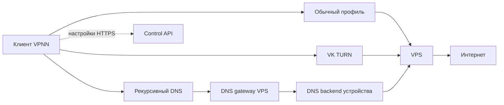

# 01. Текущее состояние VPNN

Дата: 2026-11-03. Описание существующей реализации; новые требования находятся в соседних документах.

## Архитектура

Клиент Android/Windows: Flutter/FlClash → единственный владелец системного TUN → mihomo → выбранный профиль. Managed engine встраивает FreeTurn и MasterDnsVPN. VK: TCP через TURN/DTLS/KCP/smux с bonding; DNS: TCP внутри DNS запросов/ответов через рекурсивный резолвер и делегированную зону. Обычный профиль использует возможности mihomo.

VPS: 89.125.120.163, Ubuntu amd64; HTTPS control через nginx, локальный node reconciler, DNS gateway и отдельные DNS backends устройств, общий VK relay и Xray egress. Существующие x-ui, vps-vk, nginx и fail2ban сосуществуют с VPNN. Панель vpn.chichy.space, DNS-зона v.chichy.space. Старый iPhone-контур не является частью нового клиента.

VK и DNS меняют внешний маршрут до VPS: прямой IP не обязан быть достижим с устройства, если промежуточный сервис доступен и сам достигает VPS. Это не работает при отказе самой VPS.

## Матрица состояния

| Область | Реализовано | Доказательство / ограничение |
| --- | --- | --- |
| Релиз | Активный 0.1.2+3, локальный кандидат 0.1.4+5 | Исторический срез. Актуальный локальный кандидат указан в отчёте P2 |
| VK авторизация | Новый VK Calls API, прежний ручной путь как резерв, ограниченные таймауты | Живой тест и Android-эмулятор без решателя CAPTCHA; сервис может изменить требования |
| VK скорость | TCP bonding для нескольких сессий, штатно 6 | 1 МиБ: контроль 1,11 → итог 4,40 Мбит/с; отдельный 2 МиБ тест 6,75; это не скорость МегаФона |
| Группа | Два одновременно измеренных устройства | Медианы 3,96 и 4,30 Мбит/с; не тест 8 пользователей |
| DNS | Индивидуальные ключи/домены, шифрование, SOCKS и числовые счётчики | HTTPS при запрещённом прямом доступе к VPS в эмуляторе |
| DNS оптимизация | Повторное использование подготовленных доменов | Локальный участок быстрее примерно на 28%; прирост сетевой скорости не доказан |
| Настройки | Ed25519 подпись, устройство, версия, срок, зашифрованный кэш | client/lib/vpnn/contract.dart и repository.dart |
| Первое подключение | Ссылка приглашения или подписанный offline bootstrap файл | Ссылка требует API; файл содержит стартовую конфигурацию и импортируется без API |
| Обновление | Перебор до 3 endpoints приглашения | Это не гарантированно независимые сетевые пути; `_fetch` создаёт обычный HttpClient |
| Резерв | Выбранный режим, далее direct/VK/DNS, без повторения в цикле | controller.dart; две отрицательные проверки могут инициировать переключение |
| Защита TUN | Один владелец, контроль актуальности результатов | Не вводить второй системный VPN при расширении протоколов |
| Отзыв | DNS/VK индивидуальный, подпись и подтверждение применения | Сохранённый серверный тест: до отзыва HTTPS, после settings403/DNS REFUSED |
| Диагностика | Этапы, код ошибки, безопасный JSON | Нет ключей, cookies, приглашений, полных URL звонков |
| AWG/XHTTP/TrustTunnel | Есть адаптеры в локальном mihomo | Не означает готовые управляемые VPNN-профили и серверную выдачу |
| Упаковка | Windows ZIP, три ABI APK, исходники, SHA-256 | 0.1.4 примерно 64–67 МБ на пакет, исходники и отчёт сохранены |

Источники результатов: [0.1.4](../../PERFORMANCE-0.1.4.md), [0.1.3](../../PERFORMANCE-0.1.3.md), logs/vk-calls-validation.json, logs/production-health-final.json. Тесты: 193 выбранных Flutter, анализатор, затронутые Go и Python. Это исторический результат сборки, не новый прогон в рамках исследования.

## Существенные детали, влияющие на будущий план

1. `control/store.go`: срок клиентского Payload сейчас 7 суток. Срок node payload 10 минут — другая сущность, не срок доступа пользователя.
2. `Enrollment` содержит endpoints, bearer token, публичный ключ и device ID. Публичный ключ из самого приглашения не доказывает доверие к отправителю: первое получение должно идти от владельца по доверенному каналу.
3. `repository.dart` отвергает просроченный кэш. Просто увеличивать TTL ради восстановления — изменение модели безопасности, а не исправление связи.
4. HTTP 401/403 в текущем API трактуются как отзыв. При добавлении CDN/зеркал нужно отличить авторитетный отзыв от ошибки посредника.
5. `deploy/node_sync.py`: DNS backend-служба создаётся для каждого включённого устройства с DNS-профилем. Не следует оценивать RAM только по числу активных загрузок.
6. Изменение Xray clients или relay allowlist вызывает перезапуски общих служб. Выдача/отзыв может затронуть чужие подключения; нужна отдельная работа по безопасному применению.
7. При исключении reconciler останавливает общие VPNN data-plane службы. Это существующая fail-closed политика; её нельзя молча заменить сохранением заведомо устаревших прав доступа.
8. Лимит control `max-active-devices=8` и лимит reconciler — административная защита, не результат capacity-теста.

## Не закрыто

Независимые Windows IPv4/IPv6 проверки, физический Honor и сопоставимые операторские замеры; 24 часа нагрузки; фон/сон/смена сети и батарея; 4/8 пользователей и VPS CPU/RAM; первоначальный запуск только по приглашению при заблокированной панели; подтверждённый маршрут обновления через транспорт; автоматическая ротация звонка; managed AWG и обычные профили; пользовательская облегчённая сборка; собственные подписанные обновления; восстановление на чистой ОС. Старые документы, где VK ещё всегда требует CAPTCHA, описывают предыдущее состояние.
